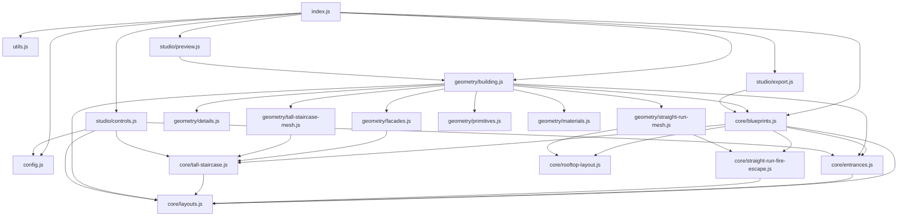

# 3D Building Generator Architecture

Open `projects/building-generator.html` to preview buildings and export models and `b.building.v1` blueprints. The generator used to live in a single script of about 4,500 lines. Start in the module that owns the behavior you want to change:

- `core/` calculates footprints, floor segments, entrances, bounds, and blueprints from configuration and seed. It can run on the server or in a headless test without browser globals or Three.js.
- `geometry/` builds Three.js meshes for facades and details. It also handles material caching and lighting modes.
- `studio/` handles controls, camera and turntable behavior, the neighborhood preview, and imports and exports.
- `index.js` starts the studio, loads dependencies, wires events, and exposes `window.BBuildingBlueprint` for existing callers.

## Source layout

```
assets/js/projects/building-generator/
├── ARCHITECTURE.md          # Architecture & developer reference documentation
├── config.js                # Base settings, presets, style metadata, options, schemas, and blueprint constants
├── index.js                 # Studio bootstrap, runtime state, lighting lifecycle, and public window interface
├── utils.js                 # Pure mathematical helpers, deterministic PRNG (rng32), hex color manipulation, DOM helpers
├── core/
│   ├── blueprints.js        # b.building.v1 blueprint generation, schema validation, and 3D bounding boxes
│   ├── entrances.js         # Spatial entrance computation, door orientation, and gameplay interaction metadata
│   ├── layouts.js           # Footprint layouts (L, U, Corner, Rect), floor setbacks, and fire escape anchors
│   ├── rooftop-layout.js    # Deterministic rooftop fixture and solid collider placement
│   ├── straight-run-fire-escape.js # Straight-run 1-unit fire escape layout math and coordinate transforms
│   └── tall-staircase.js    # Optional secondary multi-story exterior 1-unit staircase planner & feasibility checks
├── geometry/
│   ├── building.js          # Building assembly coordinator (orchestrates facades, details, roofs, props)
│   ├── details.js           # Balconies, fire escapes, awnings, rooftop props, antennas, pipes, weathering, vines
│   ├── facades.js           # Exterior walls, windows (sash/arched/tall/modern), doors (stoop/double), chamfers
│   ├── materials.js         # Solid, glass, and procedural canvas texture materials with caching & disposal
│   ├── primitives.js        # Low-level primitives: box, slabBox, cylinder, line, sagCable, and billboard signs
│   ├── straight-run-mesh.js # Straight-run fire escape and deterministic rooftop fixture mesh builders
│   └── tall-staircase-mesh.js # Secondary tall staircase C-channel stringers, cantilever brackets, and landing doors
└── studio/
    ├── controls.js          # Schema-driven UI control generator, lock buttons, inline boolean layouts, presets
    ├── export.js            # Blueprint JSON export/import, settings backup, and binary GLB export
    └── preview.js           # Studio camera, debug gizmos, streetlamps, neighborhood block generation, fullscreen
```

---

## Modules and public interfaces

### `utils.js`
- **Mathematical helpers**: `clamp(n, a, b)`, `lerp(a, b, t)`, `dist2(x1, z1, x2, z2)`.
- **Deterministic PRNG**: `rng32(seed)` provides a 32-bit mulberry32-style pseudo-random float generator `[0, 1)`. `randBetween(r, a, b)` and `randInt(r, a, b)` provide repeatable intervals without polluting global `Math.random`.
- **Color utilities**: `colorHex`, `hexToRgb`, `toHex`, `mixHex`, `darkenHex`, `lightenHex`.
- **Polygon & Geometry**: `pointInPolygon(p, vs)` for ray-casting footprint containment checks, `formatCoords(coords, precision)`.
- **DOM selectors**: `$(selector)`, `$$(selector)` (safe DOM shorthand for browser contexts).

### `config.js` (Configuration & Schema)
- **Constants**:
  - `STYLES`: Available architectural archetypes (`brick`, `brownstone`, `commercial`, `mixed`, `artdeco`, `modern`, `abandoned`, `corner`).
  - `BASE`: Canonical default parameters defining every generator key and default value.
  - `CONFIG_KEYS`: Array of active configuration keys (excluding runtime overrides).
  - `PRESETS`: Pre-configured building designs (e.g., `kings_row`, `market_street`, `paragon_brick`, etc.).
  - `OPTIONS`: Dropdown and selection dictionaries.
  - `SCHEMA`: 7 tab-categorized field definitions (`form`, `facade`, `entrances`, `rooftop`, `lighting`, `features`, `interior`) detailing types, ranges, step intervals, units, and group headers.
  - `CATEGORIES`: Mapping of settings to their respective randomization categories.
  - `NEW_EXPANSION_DEFAULTS`: Registry of feature defaults added in expansions to preserve byte-exact backward compatibility for legacy blueprint template IDs and revisions.
  - `BLUEPRINT_SCHEMA_VERSION`: Standardized string (`b.building.v1`).
- **Functions**:
  - `getStyle(styleId)`: Looks up style metadata with fallback.
  - `baseForStyle(styleId)`: Returns the baseline merged with style preset.
  - `sanitisePreset(settings)`: Validates and bounds untrusted user settings against schema limits.

### `core/layouts.js` (Footprint & Floor Layouts)
- **Functions**:
  - `subtractIntervals(start, end, blocked)`: Computes unoccluded 1D intervals along an exterior wall span.
  - `makeSeg(x, z, w, d, options)`: Creates standard bounding segment descriptors.
  - `segmentsForFloor(cfg, floor)`: Computes rectangular and courtyard floor segments based on footprint type (`rectangle`, `L`, `U`, `corner`), extensions, and floor setbacks.
  - `chooseFireEscapePlacement(groundSegments, cfg, r)`: Determines optimal exterior wall placement for continuous fire escape landings.
  - `getFireEscapeWallAnchor(seg, side, coord)`: Calculates 3D world anchor coordinates for a fire escape deck.
  - `computeFireEscapeMetadata(cfg, groundSegments)`: Derives semantic traversal components (landings, railings, stair flights, drop ladder with raised/lowered states, roof access ladder) for collision systems.
  - `computeBuildingWindows(cfg, groundSegments)`: Generates a complete spatial registry of windows with stable IDs (`win_f{floor}_{side}_{col}`), local positions, dimensions, room grouping (`roomId`), and lit states.

### `core/entrances.js` (Entrances & Interaction Gameplay)
- **Functions**:
  - `computeDefaultEntranceGameplay(cfg)`: Derives recommended trigger dimensions, category, and interaction distances based on ground usage (`residential`, `shop`, `lobby`) and door styles.
  - `computePrimaryEntranceLayout(cfg, groundSegments)`: Calculates primary entrance position, normal vector, approach coordinates, and trigger geometry.
  - `computeCornerEntranceLayout(cfg, groundSegments)`: Calculates 45-degree angled corner entrance for chamfered footprints.
  - `computeRearEntranceLayout(cfg, groundSegments)`: Places rear service door on exposed rear-facing wall (accounting for extensions and setbacks).
  - `computeSideEntranceLayout(cfg, groundSegments, side)`: Places left or right side exterior doors on exposed side walls.
  - `computeBasementEntranceLayout(cfg, groundSegments)`: Places exterior angled cellar storm door with ground-level approach coordinates.
  - `computeDeliveryEntranceLayout(cfg, groundSegments)`: Places commercial roll-up garage bay with vehicular approach volume.
  - `computeRooftopEntranceLayout(cfg, groundSegments)`: Places roof access door on stairwell headhouse at roof deck elevation.
  - `buildEntranceDefinition(options)`: Standardizes entrance JSON schema conforming to `b.building.v1`.
  - `computeBuildingEntrances(cfg, groundSegments)`: Orchestrates primary and all enabled auxiliary/service/rooftop entrances with stable IDs.

### `core/blueprints.js` (Blueprint Contracts)
- **Functions**:
  - `computeBuildingBounds(cfg, groundSegments, entrances)`: Derives local and world AABB bounds (`min`, `max`, `size`, `center`), accounting for roof structures and stairwell headhouse.
  - `generateBuildingBlueprint(cfg, options)`: Generates full deterministic `b.building.v1` document containing template ID, revision hash, sanitized configuration, 3D bounds, and gameplay entrances. Prunes unconfigured expansion defaults to strictly preserve existing blueprint invariants (e.g. Brownstone #4612 `bldg_tpl_brownstone_4612_b9c6e562c1a1` / `rev_9bac4ec8df221d3a`). Populates companion metadata under `blueprint.metadata` for fire escape components, window registry, rooftop structures, and lighting profile.
  - `validateBuildingBlueprint(data)`: Validates blueprint structure, required fields, coordinate integrity, and trigger bounds.

### `geometry/materials.js` (Procedural Materials & Textures)
- **Functions**:
  - `solid(hex, options)`: Retrieves or instantiates cached `THREE.MeshLambertMaterial`.
  - `glassMaterial(hex, lit, options)`: Generates window/door glass material reacting to time-of-day lighting modes (`day`, `golden_hour`, `evening`, `night`, `late_night`, `morning`) and occupancy profiles (`residential`, `commercial`, `derelict`).
  - `graffitiMaterial(seed, options)`: Procedural canvas generator synthesizing urban tags, stencils, and street posters.
  - `textureMaterial(kind, mainHex, secondaryHex, mortarHex, cfg, keySeed, width, height)`: Synthesizes procedural brick, stone, and concrete canvas textures with anisotropic filtering.
  - `clearMaterialCache()`: Disposes Three.js textures and materials cleanly to prevent GPU memory leaks.
  - `setMaterialLightingMode(mode)`: Informs procedural materials of the active environment lighting scheme.

### `geometry/primitives.js` (Geometric Building Blocks)
- **Functions**:
  - `worldRoot(parent, x, y, z)`: Instantiates a `THREE.Group` positioned at given coordinates.
  - `box(parent, x, y, z, w, h, d, material, options)`: Allocates and positions a box mesh with optional shadow casting/receiving.
  - `slabBox(parent, seg, y, h, inset, material)`: Produces floor or ceiling slabs adhering to footprint segment bounds.
  - `cylinder(parent, x, y, z, rTop, rBottom, h, material, segments)`: Produces rooftop vents, water towers, and pipes.
  - `line(parent, p1, p2, thickness, material)`: Synthesizes 3D linear geometry (cables, fire escape rails, antennas).
  - `sagCable(parent, p1, p2, sag, thickness, material)`: Procedural catenary cables for rooftops.

### `geometry/facades.js` & `geometry/details.js`
- **Facades**:
  - `wallForSide(...)`: Assembles wall segments, calculates window spacing, cuts door openings across all exposed walls (front, back, left, right), applies brick/stone texture or paint overrides.
  - `addWindow(...)`: Assembles detailed window frames, named `WindowPane_{winId}` glass meshes with `userData` (windowId, roomId, floor, facade, lit) for runtime engine inspection and GLTF export preservation.
  - `addDoor(...)`: Builds entrances, stoops, double doors, and glass shopfronts.
  - `addCornerChamfer(...)`: Builds 45-degree corner walls on corner-cut lots.
- **Details**:
  - `addFireEscape(...)`: Multi-story fire escape stairs, alternating landing decks, drop ladder (raised or lowered states), top-floor parapet roof access ladder, and safety railings.
  - `addRooftopHeadhouse(...)`: Stairwell access structure (brick, concrete, metal, decorative, industrial) with flat/sloped roof, steel door, and overhead gooseneck exterior light.
  - `addVentilationFans(...)`: Static/box-mounted/industrial rooftop exhaust units with cylindrical cowl and rotor hub.
  - `addRoofAccessHatch(...)`: Hinged metal maintenance hatch with perimeter coaming curb and padlock latch.
  - `addRooftopWalkways(...)`: Duckboard maintenance walkways connecting roof structures.
  - `addSafetyRailings(...)`: Perimeter safety railings along roof edges.
  - `addAdditionalEntrances(...)`: Geometry generation for rear service doors, side entrances, cellar storm doors, and commercial delivery roll-up bay.
  - `addGraffiti(...)`: Procedural street art decals on lower exterior walls avoiding doors/windows.
  - `addBalcony(...)`: Exterior ornamental balconies for upper residential floors.
  - `addRoof(...)` & `addRooftopProps(...)`: Parapets, mansard slopes, skylights, water tanks, hvac units, antennas, and chimneys.
  - `addVines(...)` & `addSurfaceWeathering(...)`: Overgrowth ivy clusters, grime, and roof tar patches.

### `core/straight-run-fire-escape.js`, `core/rooftop-layout.js` & `geometry/straight-run-mesh.js`
- **`core/straight-run-fire-escape.js`** (`Dom`-free & `Three.js`-free):
  - `STRAIGHT_RUN_UNITS_PER_METER`: Canonical conversion factor (`16.404199475065617` B game units per meter; 5 units per foot).
  - `STRAIGHT_RUN_PROFILE`: 1.00 m clear tread width, 0.28 m wall standoff, 1.34 m landing depth, 0.90 m roof ladder portal opening, 0.06096 m (1 B unit) step run target and 1 B unit step rise target (`~45 deg` continuous straight run).
  - `computeStraightRunFireEscape(groundSegments, placement, cfg)`: Computes unobstructed straight-run flights (`<= 64` treads per flight), full-depth landings, stepped side railing barriers, drop ladder, F3 roof portal landing (`fe_landing_f3_portal`), and rooftop ladder (`fe_ladder_roof`). Reports `feasible: false` and `traversalValidation.status: 'layout_limitation_reported'` with descriptive `limitations` and 0 stair flights when a facade lacks required usable span.
  - `computeRoofDeckAndParapetTop(cfg)`: Computes shared roof deck elevation and parapet top height for roof ladder termination.
- **`core/rooftop-layout.js`** (`Dom`-free & `Three.js`-free):
  - `ROOFTOP_B_UNITS_PER_METER`: Metric-to-B-unit conversion factor (`16.404199475065617`).
  - `computeDeterministicRooftopLayout(cfg, topSegments, groundMain)`: Deterministically places substantial rooftop structures (`headhouse`, `water_tank`, `ventilation_fan`, `roof_hatch`, `chimney`, `hvac_unit`, `exhaust_vent`) and emits exact Aabb colliders (`localBoxMeters` and `coordinatesZUp.bGameUnits.boundsMinMax`) while leaving thin decorative details (`antenna_masts`, `thin_conduits_and_cables`, `flush_walkway_planks`) uncollided.
  - `computeRooftopStructuresMetadata(cfg, topSegments, groundMain, includeColliders)`: Returns legacy summary flags when `rooftopCollision` is disabled, or enriched fixture and semantic collider arrays when `rooftopCollision` is enabled.
- **`geometry/straight-run-mesh.js`**:
  - `addStraightRunFireEscapeGeometry(parent, groundSegments, placement, cfg)`: Builds straight-run steel stair treads, landings, brackets, stepped railings, and roof/drop ladders directly from `computeStraightRunFireEscape` metadata (`userData.treadId`, `userData.componentId`).
  - `addDeterministicRooftopGeometry(group, topSegments, groundMain, cfg)`: Builds rooftop fixtures directly from `computeDeterministicRooftopLayout`, attaching `userData.rooftopColliderId` on collidable sub-meshes.

### `core/tall-staircase.js` & `geometry/tall-staircase-mesh.js`
- **`core/tall-staircase.js`** (`Dom`-free & `Three.js`-free):
  - `chooseTallStaircasePlacement(groundSegments, cfg, conventionalPlacement)`: Selects an unobstructed exterior facade opposite any active conventional fire escape (`tallStaircaseSide: 'auto'`), or validates a user-requested facade.
  - `computeTallStaircaseLayout(groundSegments, cfg, conventionalPlacement)`: Computes continuous multi-story 1-unit flights (`<= 64` treads per flight), elevated landing platforms, aligned access doorway bands, per-floor window/balcony/`Ac` exclusion intervals (`floorExclusions`), optional drop/roof parapet ladders, and explicit feasibility `limitations` when a building cannot accommodate the staircase.
  - `isWallPointBlockedByTallStaircase(tallLayout, side, floorIndex, centerCoord, halfWidth)`: Shared check queried by `facades.js` and `computeBuildingWindows` so conflicting windows, shutters, balconies, and `Ac` units are omitted cleanly.
  - `summarizeTallStaircaseMetadata(tallLayout)`: Emits `metadata.tallStaircase` only when enabled in configuration.
- **`geometry/tall-staircase-mesh.js`**:
  - `addTallStaircaseGeometry(parent, groundSegments, cfg, conventionalPlacement)`: Synthesizes grounded street approach plinth, inclined C-channel steel stringers, bolted cantilever wall brackets and 45-degree knee braces, 1-unit treads, aligned steel landing doorways with sill plates and trims, portal-cleared guardrails (`full`, `industrial`, `open_inner`), and optional drop/roof ladders.

### `geometry/building.js`
- **Functions**:
  - `createBuilding(cfg, options)`: Assembles complete building `THREE.Group`, attaches `userData.blueprint` and `userData.entrances`, and dispatches straight-run fire escape and deterministic rooftop mesh builders when enabled.

### `studio/controls.js` (UI Controls & State Management)
- **Separation of layout and input generation**:
  - `createInputControl(item, value, options)`: Pure input element creator (sliders, dropdowns, checkboxes, color pickers).
  - `createLockButton(key, isLocked, onToggle)`: Generates toggleable variation lock icon.
  - `renderInlineBooleanFieldLayout(...)`: Compact single-line layout helper for future UI improvements (`[Checkbox] [Lock] Label`).
  - `renderStandardFieldLayout(...)`: Standard studio row with title, lock button, input, and value readout badge.
  - `renderFieldLayout(...)`: Dispatches appropriate layout renderer based on schema specification.
  - `applyDependentRules(...)`: Coordinates dynamic field relationships (e.g., auto-updating trigger dimensions when ground use changes).
  - `renderControls(...)`: Renders active tab configuration fields.
  - `randomizeSettings(category, state, locks, context)`: Randomizes unlocked parameters in specified categories.

### `studio/preview.js` & `studio/export.js`
- **Preview**:
  - Camera control, damping, lighting transitions (`day`, `evening`, `night`).
  - Debug gizmos: Visualizes entrance triggers (`BoxHelper`) and billboard metadata sprites (`#1 [Apartment]`).
  - City block preview: Generates procedural neighboring buildings to evaluate architectural context.
- **Export**:
  - `exportBlueprint(state, options)`: Downloads `b.building.v1` JSON blueprint.
  - `exportJSON(state, options)`: Exports raw generator configuration.
  - `exportGLB(state, createBuildingFn, options)`: Invokes `THREE.GLTFExporter` for binary 3D model download.
  - `applyImportedBuildingData(parsed, label, callback)`: Safely parses and applies imported blueprints or configs.

---

## Initialization Flow & Dependency Graph



### Studio startup
1. User loads `projects/building-generator.html`.
2. Browser executes `assets/js/projects/building-generator.js`.
3. `initUI()` binds tabs, buttons, preset selectors, and input listeners.
4. `loadDependencies()` dynamically loads Three.js (r128), `OrbitControls`, and `GLTFExporter`.
5. `initScene()` initializes WebGLRenderer, Scene, Camera, OrbitControls, and Hemispheric/Sun lighting.
6. `rebuild()` generates initial building geometry via `createBuilding(state)`.
7. `window.BBuildingBlueprint` registers the compatibility contract for external game systems.

---

## Reusing Shared Logic in Game Systems

Import these functions from `core/` to calculate layouts, bounds, or entrances on the server or in a headless test.

```javascript
// Node.js or game server import
import { generateBuildingBlueprint, validateBuildingBlueprint } from './core/blueprints.js';
import { computeBuildingEntrances } from './core/entrances.js';
import { segmentsForFloor } from './core/layouts.js';

// Deterministic generation from seed and style
const blueprint = generateBuildingBlueprint({
  style: 'brownstone',
  seed: 4612,
  floors: 4
});

console.log('Template ID:', blueprint.templateId);
console.log('Bounding Box:', blueprint.bounds);
console.log('Entrances:', blueprint.entrances);
```

---

## Adding a feature or setting

### Adding a New Configuration Setting
1. Add the default value to `BASE` in `config.js`.
2. Add a descriptor to the appropriate tab in `SCHEMA`.
   ```javascript
   {
     key: 'myFeature',
     label: 'My Architectural Feature',
     type: 'boolean', // or 'range', 'select', 'color'
     group: 'Structural Details'
   }
   ```
3. Add the key to `form`, `facade`, `features`, or `palette` in `CATEGORIES`.
4. Read `cfg.myFeature` in `geometry/details.js` or `geometry/facades.js`.
5. Rebuild the bundle with `node scripts/build-building-generator.js`.
6. Run `node tests/verify.js`.

---

## Build and test

- **Build distribution bundle**:
  ```bash
  node scripts/build-building-generator.js
  ```
- **Run the regression tests**:
  ```bash
  node tests/verify.js
  ```
- **Update regression baselines** (only when intentionally changing geometry contract):
  ```bash
  node tests/generate-baseline.js
  ```

---

## GLB and blueprint JSON exports

Export the blueprint JSON and GLB together. The game reads them for different parts of the same asset.

| Attribute / Feature | Blueprint JSON (`.building.json`) | 3D Asset (`.glb`) |
| :--- | :--- | :--- |
| **Primary Consumer** | Game server, collision system, navigation AI | WebGL / Three.js game client rendering |
| **Contract Schema** | `b.building.v1` schema specification | Binary glTF 2.0 (`model/gltf-binary`) |
| **Identity & Revisions** | `templateId`, `templateRevision` hash | Root node `extras.blueprint.templateRevision` |
| **AABB Bounds** | Exact calculated `min`, `max`, `size`, `center` | Visual geometry mesh bounds |
| **Entrances** | Full gameplay definitions: `role`, `category`, `approachCoords`, `triggerBounds`, `normalVector` | Visual doors, frames, awnings, and stoops |
| **Fire Escape Traversal** | Semantic components: `walkable_surface`, `stair_ramp`, `barrier`, `climbable_ladder` | Visual ironwork meshes, railings, ladder rungs |
| **Window Registry** | Full registry with spatial positions, dimensions, room groupings (`roomId`), lit status | Named `WindowPane_*` mesh nodes with `extras` (`windowId`, `roomId`, `floor`, `facade`, `lit`) |
| **Window Emissive Glow** | Lit boolean flag in registry | `emissiveFactor` in glTF material definitions |
| **Rooftop Bounds** | Expanded AABB covering headhouses and equipment | Visual meshes for headhouse, hatch, HVAC, water tank |
| **Debug Gizmos** | Excluded | Excluded (strictly isolated on `debugGroup`) |

---

## Fire Escape Traversal & Stair Tread Collision Contract

### Collision integration
To allow players in B Remastered to naturally walk up fire escape stairs without collision obstruction, the generator exports accurate, deterministic stair tread collision shapes alongside flight descriptors.

When `fireEscapeTreads` is enabled:
- The generator produces individual, physical horizontal step collision surfaces (`type: 'stair_tread'`).
- The previous monolithic stair envelope (`traversal: 'stair_ramp'`) is replaced by individual walkable step platforms (`traversal: 'stair_tread'`) and a flight descriptor (`traversal: 'stair_flight'`).
- B Remastered's collision system can instantiate standard static horizontal box colliders for each tread without needing a special climbing movement state.

### Coordinate System Mapping (Y-Up vs B Remastered Z-Up)
The Building Generator operates in Three.js **Y-Up** (meters):
- $+X$: Building Right / Facade lateral axis
- $+Y$: Vertical Elevation (Up)
- $+Z$: Building Front / Facade normal axis (outward from facade)

B Remastered operates in **Z-Up** (meters and game units):
- $X_b = X_{gen}$
- $Y_b = -Z_{gen}$ (**negative Z!**)
- $Z_b = Y_{gen}$ (Vertical Elevation)
- Scale factor: $1.0\text{ meter} = 16.4042\text{ game units}$ (based on 5 units per foot / $0.3048$).

Each landing, flight, and stair tread includes an explicit `coordinatesZUp` object in its metadata containing both metric and game-unit representations:
```json
{
  "id": "fe_tread_f1_to_f2_s1",
  "flightId": "fe_flight_f1_to_f2",
  "type": "stair_tread",
  "floor": 1,
  "stepIndex": 1,
  "stepCount": 16,
  "elevation": 3.6325,
  "topSurfaceElevation": 3.655,
  "position": { "x": 6.85, "y": 3.6325, "z": -0.65 },
  "dimensions": { "width": 0.76, "height": 0.045, "depth": 0.24 },
  "traversal": "stair_tread",
  "walkable": true,
  "treadMetrics": {
    "run": 0.24,
    "width": 0.76,
    "thickness": 0.045,
    "stepRise": 0.2125,
    "stepRun": 0.24
  },
  "coordinatesZUp": {
    "position": { "x": 6.85, "y": 0.65, "z": 3.6325 },
    "elevation": 3.6325,
    "topElevation": 3.655,
    "dimensions": { "width": 0.76, "depth": 0.24, "height": 0.045 },
    "normal": { "x": 1, "y": 0, "z": 0 },
    "bGameUnits": {
      "position": { "x": 112.369, "y": 10.663, "z": 59.588 },
      "elevation": 59.588,
      "topElevation": 59.957,
      "dimensions": { "width": 12.467, "depth": 3.937, "height": 0.738 }
    }
  }
}
```

### Clearance Profiles & Alternating Switchback Stair Proportions
The generator provides four configurable clearance profiles via `fireEscapeClearance` (`'standard'` default = Classic Alternating Switchback, `'generous'` = Large-Model Alternating Switchback, `'straight_run'` = Straight-Run Vertical Stack, `'legacy'` = Compact Legacy):

| Dimension / Metric | Legacy (`'legacy'`) | Standard (`'standard'`) | Generous (`'generous'`) | Notes |
| :--- | :--- | :--- | :--- | :--- |
| **Collision Capsule Diameter** | 0.60 m | 0.60 m | 0.70 m | Supported player body |
| **Visual Character Width** | 0.62 m | 0.62 m | 0.72 m | Reference figure width |
| **Player Headroom** | 2.05 m | **2.15 m min** | **2.20 m min** | Dynamic deck cutout soffit check |
| **Stair Clear Tread Width** | 0.36 m | **0.98 m** | **0.96 m** | Full clear tread width |
| **Landing Platform Depth** | 1.22 m | **2.25 m+** | **2.35 m+** | Side-by-side dual-lane depth |
| **Turnaround Platform Run** | 0.44 m | **0.90 m** | **0.98 m** | Unobstructed U-turn landing ends |
| **Ladder Railing Opening** | 0.00 m (solid) | **0.80 m (+ extra)** | **0.90 m (+ extra)** | Unobstructed ladder gate width |
| **Wall Shutter Standoff** | 0.12 m | **0.24 m (+ standoff)** | **0.30 m (+ standoff)** | Clears exterior window trim/shutters |
| **Flight Pattern per 3.4 m Floor** | Alternating stack | **True Alternating Switchback** | **True Alternating Switchback** | Lane B (`W -> E`) / Lane A (`E -> W`) |
| **Treads per 3.4 m Floor** | 10 treads | **15 treads (16 risers)** | **15 treads (16 risers)** | Walkable ~40 deg full-story runs |
| **Riser Height per Step** | 0.34 m (steep) | **0.2125 m** | **0.2125 m** | Comfortable natural climb |

### Switchback stair layout
With `'standard'` and `'generous'`, each full-story flight switches direction and moves to the other lane. The outer and inner lanes keep the flights from crossing and remove the need for mid-flight landings.
- **Optional Ground Entry (`F0 -> F1`, `fireEscapeLadder: 'stair'`)**: Runs `East -> West` (`+X -> -X`) in inner Lane A (`zInner`) from a concrete ground landing pad to Floor 1 (`fe_flight_f0_to_f1`). When set to `'raised'` or `'lowered'`, a vertical Drop Ladder attaches at Floor 1's `-X` outer Lane B portal instead.
- **Odd Upper Flights (`F1 -> F2`, `F3 -> F4`, ...)**: Run `West -> East` (`-X -> +X`) along outer **Lane B (`zOuter`)**.
- **Even Upper Flights (`F2 -> F3`, `F4 -> F5`, ...)**: Reverse to `East -> West` (`+X -> -X`) along inner **Lane A (`zInner`)**.
- **Flush Step Alignment & Cutout Headroom**: Treads space evenly across `totalHorizontalRun` (`xRunMin..xRunMax`) so consecutive risers and landings join without jagged overhang gaps. Every arrival landing dynamically slices its deck into `walkablePanels` around a framed `openings` stairwell (`uCut` fraction ensuring `verifiedSoffitHeadroom >= 2.15 m` / `2.20 m`), guarded around the opening on exposed sides while leaving entrance/exit portals open.
- **Structural Supports (`fireEscapeSupportStyle`)**: Supports `'columns_and_braces'` (default outer corner vertical ground columns plus spandrel knee braces), `'wall_brackets'` (diagonal braces without street columns), and `'columns_only'`.
- **Exposed Tuning Controls (`Exterior Fire Escapes`)**: `fireEscapeLadder` (Drop Ladder & Bottom Access Mode: `'raised'`, `'lowered'`, `'stair'`), `fireEscapeSupportStyle`, `fireEscapeRoofAccess`, `fireEscapeRoofLandingSize` (0 = auto), `fireEscapeWallStandoff`, `fireEscapeStairWidth`, `fireEscapeLandingDepth`, `fireEscapeLadderClearance`, and `fireEscapeTreads`.

### Railing Openings, Ladders & Turnaround Platforms
- **Floor 1 Drop Ladder (`fe_ladder_drop`, `'raised'` / `'lowered'`)**: Symmetric `0.80 m` (`+ fireEscapeLadderClearance`) portal on Floor 1's `-X` outer end feeding straight onto the West-to-East flight turnaround, with upper deck & top-rail mounting brackets.
- **Top Floor Roof Gooseneck Ladder (`fe_ladder_roof`)**: Positioned at the opposite turnaround end where the top flight arrives, ascending straight from the landing deck through the parapet crest onto `roofDeckY` with steel roof-deck baseplates and parapet tie brackets.
- **Additional Metadata**: `metadata.fireEscape` exposes `layoutStyle: 'alternating_switchback'`, `supportStyle`, per-flight `directionLabel` / `lane` / `laneIndex`, per-landing `walkablePanels` & `openings`, structural `supports` (`support_column` / `support_brace`), and `traversalValidation.headroomChecks`.

### Traversal validation
Traversal validation results are exposed under `metadata.fireEscape.traversalValidation` and in `metadata.fireEscape.walkableRoutes[0]`:
- `status`: `'geometric_clearance_bounded'` when all envelopes are clear without bounding collisions, or `'geometric_clearance_constrained'` when building geometry imposes spatial restrictions.
- `disclaimer`: `"Static geometric clearance envelopes verified without bounding collisions. Dynamic player navigation and movement physics require in-engine testing in B Remastered."`
- `verifiedPassages`: Validates `stairPassage`, `ladderPortal`, `turnaroundPlatform`, `wallShutterStandoff`, and `verticalHeadroom` with numerical margins.

### Generator Defaults & Backward Compatibility
- **Active Generator & Studio Defaults**: `BASE` defaults newly generated buildings to `fireEscapeClearance: 'standard'`, `fireEscapeLadderClearance: 0.0` (`0m`), `fireEscapeStairWidth: 0.98` (`0.98m`), `fireEscapeLandingDepth: 2.25` (`2.25m`), and `tallStaircase: false`.
- **Existing exports**: Historical exported assets under `assets/exports/` (`brownstone-4612-legacy.building.json` `rev_9bac4ec8df221d3a`, `brownstone-4612-revised.{building.json,glb}` `rev_3a7104e6fa95fdee`, and `brownstone-4612-straight-run.{building.json,glb}`) remain untouched until explicitly approved.
- **Export Scripts**:
  - `node b-website/scripts/export-revised-brownstone.mjs --preview-dir <dir>`: Exports candidate preview blueprints and `.glb` models into an isolated preview folder without overwriting approved files in `assets/exports/`.

### Straight-Run 1-Unit Walkable Fire Escape (`'straight_run'`)
- **Stair dimensions**: Instead of switchback turns, `'straight_run'` arranges all flights along a single continuous unobstructed facade lane (`1.00 m` clear width, `0.28 m` wall standoff clearing `0.16 m` window sills/shutters) with `56` steps per `3.4 m` floor (`risePerStep = 0.060714 m`, `runPerStep = 0.06096 m` = `1.000` B game unit at `16.4042` units/m, `44.88°` incline), well within B Remastered's `4`-unit player step height.
- **Tread & Component Caps**: Each flight stays within `building-blueprints.js`'s `64`-tread limit (`56 <= 64`) and total components stay within `512` (`144` components on 4-floor Brownstone #4612).
- **Railings & Rooftop Access**: Stepped quarter-flight side barrier segments prevent lateral walk-offs while preserving clean inline continuity between flights and landings. Top floor (`F3`) includes `fe_landing_f3_portal` bridging to the wall and `fe_ladder_roof` extending above parapet height.
- **When the layout does not fit**: If a building's usable exposed wall span cannot accommodate continuous 1-unit runs or exceeds server limits, `computeStraightRunFireEscape` sets `feasible: false` and `traversalValidation.status: 'layout_limitation_reported'` with descriptive `limitations` and `warnings`, emitting `0` stair flights or impassable geometry.

---

## Door and stoop dimensions

`addDoor` (`geometry/facades.js`), `addEntrance` (`geometry/details.js`), and the entrance metadata all use `resolveDoorDimensions(cfg, wide)` from `core/entrances.js`.
- **Single Door Baseline**: `1.06m` wide by `clamp(floorHeight * 0.57, 1.96, 2.12)` tall (approx. `1.96m` on `3.4m` Brownstone floors), paired with slim `0.11m` jambs, lintels, and pilasters.
- **Double / Commercial Door Baseline**: `1.76m` wide by `clamp(floorHeight * 0.60, 2.04, 2.22)` tall.
- **Custom Overrides**:
  - `doorScale`: Uniform multiplier (range: 0.70 to 1.30, default 1.0).
  - `doorWidth`: Explicit width override in meters (range: 0.90m to 2.80m).
  - `doorHeight`: Explicit height override in meters (range: 1.90m to 3.20m).
- **Stoop dimensions**: `stepH = 0.135m`, `stepD = 0.27m`, `landingD = 0.82m` (`0.58m` non-stoop), and `stoopW = clamp(doorWidth + 0.66, 1.50, 2.10)` (`1.72m` for single doors; `clamp(doorWidth + 0.72, 2.00, 2.80)` for wide doors), with slender `0.10m` stone curbs topped by open steel handrails and balusters.

---

## Rooftop collision

When `rooftopCollision: true` is enabled in configuration:
- `computeDeterministicRooftopLayout` places substantial structural rooftop fixtures deterministically and generates paired mesh and collision descriptors consumed by both `addDeterministicRooftopGeometry` and `computeRooftopStructuresMetadata`.
- **Included Solid Colliders** (`traversal: 'barrier'`, `solid: true`): `headhouse`, `water_tank` (`supports` + `barrel`), `chimney` (`shaft` + `cap`), `hvac_unit`, `exhaust_vent`, `ventilation_fan`, and `roof_hatch`.
- **Excluded Decorative Details** (`excludedDecorativeDetails`): Thin or flush cosmetic elements such as `antenna_masts`, `thin_conduits_and_cables`, and `flush_walkway_planks` do not emit solid barrier colliders.
- **Collider Entry Shape**: Each entry in `metadata.rooftopStructures.colliders` provides Three.js Y-up `position` and `dimensions`, Z-up `coordinatesZUp` (`position`, `dimensions`, `min`, `max`), `localBoxMeters`, and `coordinatesZUp.bGameUnits.boundsMinMax` scaled by `16.404199475065617` units/m.

---

## Fire escapes and the optional exterior staircase

- **Preset defaults**: All built-in presets retain the conventional fire escape (`fireEscape`) as default with `tallStaircase: false` (`NEW_EXPANSION_DEFAULTS`), which keeps baseline silhouettes and template revisions unchanged (`rev_9bac4ec8df221d3a`).
- **Studio Configuration (`Details` -> `Exterior Fire Escapes`)**:
  - `fireEscape`: Enables or disables the conventional compact/standard/generous fire escape.
  - `tallStaircase`: Enables the optional secondary continuous 1-unit exterior staircase (`tallStaircaseSide`, `tallStaircaseWidth`, `tallStaircaseClearance`, `tallStaircaseFloors`, `tallStaircaseLanding`, `tallStaircaseRailing`).
  - Both systems can coexist independently; `'auto'` placement automatically selects an unobstructed facade opposite any active conventional fire escape (e.g., Left wall when Conventional occupies Right).
  - Studio renders a live `#tall-staircase-status` confirmation or limitation warning banner in the Details tab whenever the active building dimensions, wall conflicts, or floor settings prevent a feasible layout, and the generator skips the stairs.
- **Node CLI Material Preservation (`b-website/scripts/lib/software-canvas.mjs`)**:
  - CLI preview/batch exports use `SoftwareCanvas` (`fillRect`, `strokeRect`, `lineTo`, `arc`, `drawImage` with `translate`/`scale` Y-flip transforms, and zlib PNG encoding) paired with `clearMaterialCache()` to export procedural brick and stone textures from Node.js. Export scripts require `--preview-dir <dir>` or explicit `--write-exports`.

---

## Player scale reference in the studio

- **Standing positions (`computePlayerReferenceSpots` in `core/entrances.js`)**: Resolves surface-grounded standing positions for `Front Door`, `Front Stoop`, `Drop Ladder`, `Stair Landing`, `Roof Access`, and (when feasible) `Tall Stair Entry` and `Tall Stair Landing`.
- **Visual Reference (`buildPlayerScaleReference` in `studio/preview.js`)**: Renders an unexported low-poly `1.82m` human mannequin with a translucent `0.60m` collision capsule footprint halo inside `debugGroup` only, toggled via `#btn-player-ref`, `#player-ref-toggle`, and `#player-ref-spot` in `building-generator.html`. Exported `.glb` files never include the reference model.
